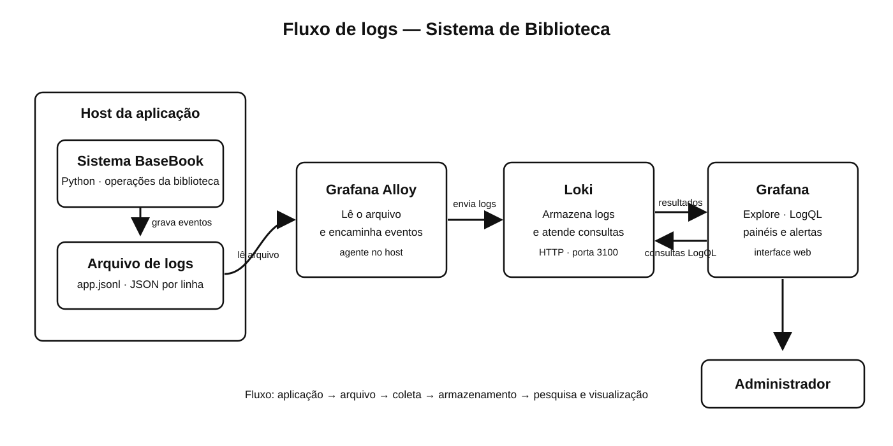

# Proposta de logs — Sistema de Biblioteca

Repositório: <https://github.com/Devwalis/basebook/tree/feat/observabilidade-logs>

## 1. Eventos que devem gerar logs

Os registros seriam escritos em JSON, um evento por linha, em um arquivo como `/var/log/basebook/app.jsonl`. Cada linha teria data e hora, nível, nome do evento e uma mensagem. Quando necessário, incluiria IDs da operação e dos registros relacionados. Senhas nunca devem aparecer nos logs.

Exemplos:

```json
{"timestamp":"2026-11-02T08:30:00-03:00","level":"INFO","event":"login_success","user_id":12}
{"timestamp":"2026-11-02T08:31:00-03:00","level":"WARNING","event":"login_failed"}
{"timestamp":"2026-11-02T08:32:00-03:00","level":"INFO","event":"user_registered","user_id":18}
{"timestamp":"2026-11-02T08:33:00-03:00","level":"INFO","event":"book_registered","book_id":42,"copies":3}
{"timestamp":"2026-11-02T08:35:00-03:00","level":"INFO","event":"loan_created","loan_id":93,"user_id":12,"book_id":42}
{"timestamp":"2026-11-02T08:36:00-03:00","level":"WARNING","event":"operation_rejected","feature":"emprestimo"}
{"timestamp":"2026-11-02T08:36:30-03:00","level":"ERROR","event":"operation_failed","feature":"emprestimo","error_type":"OSError"}
{"timestamp":"2026-11-02T08:37:00-03:00","level":"ERROR","event":"storage_write_failed","feature":"cadastro_livro"}
```

`INFO` registra ações concluídas; `WARNING`, tentativas inválidas ou operações recusadas por regras do sistema; `ERROR`, falhas inesperadas que precisam ser investigadas. Os dados pessoais devem ser reduzidos ao mínimo necessário. IDs podem ficar no conteúdo do log, mas não como labels do Loki.

O projeto atual guarda os dados em `dados/biblioteca.json`, não em banco de dados. Portanto, o exemplo de falha de persistência usa `storage_write_failed`. Se o sistema passar a usar banco, a falha de conexão pode ser registrada como `database_connection_failed`.

## 2. Tecnologia escolhida: Grafana Loki

Escolhemos Loki porque a aplicação é pequena e produz logs de texto que podem ser coletados diretamente de arquivo. A proposta usa três componentes:

- **Grafana Alloy**, instalado junto à aplicação, lê `/var/log/basebook/app.jsonl` e encaminha as linhas ao Loki.
- **Loki** recebe e armazena os registros. Usa labels simples, como `app`, `env` e `level`, para organizar as streams; os demais campos ficam no conteúdo JSON.
- **Grafana** consulta o Loki com LogQL. O administrador pode pesquisar eventos no Explore e montar painéis.

Essa opção atende ao porte do Sistema de Biblioteca sem acrescentar Logstash ou uma instalação Elasticsearch. Como limitações, é preciso configurar retenção e armazenamento persistente para o Loki, e consultas dependem de labels bem escolhidas. IDs de usuário, livro e empréstimo não devem virar labels, pois criariam alta cardinalidade.

## 3. Diagrama e caminho dos logs



O processo é: a aplicação gera uma linha JSON; o arquivo fica no host; o Alloy acompanha o arquivo e envia os registros por HTTP; o Loki armazena e disponibiliza as consultas; o Grafana mostra os resultados ao administrador.

## 4. Consultas que o administrador poderia fazer

As consultas abaixo são exemplos de LogQL. Os labels `app` e `env` são definidos na configuração de coleta.

1. **Localizar erros:**

   ```logql
   {app="basebook", env="prod"} | json | level="ERROR"
   ```

2. **Encontrar tentativas de login malsucedidas:**

   ```logql
   {app="basebook", env="prod"} | json | event="login_failed"
   ```

3. **Consultar empréstimos realizados:**

   ```logql
   {app="basebook", env="prod"} | json | event="loan_created"
   ```

4. **Investigar falhas na funcionalidade de empréstimo:**

   ```logql
   {app="basebook", env="prod"} | json | event="operation_failed" | feature="emprestimo"
   ```

No Grafana, o administrador selecionaria o período da ocorrência, executaria a consulta no Explore e abriria as linhas retornadas para ver a mensagem e os campos do evento.

## 5. Entrega

O diagrama está em `entregaveis/arquitetura-logs-loki.svg`. Esta atividade é uma proposta de arquitetura: a aplicação ainda não foi alterada para emitir esses logs e os componentes Loki não foram instalados.
